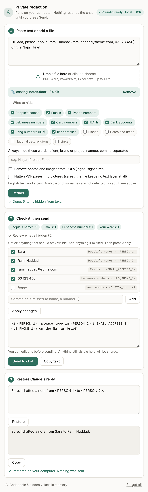
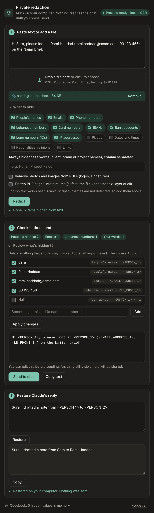

# LLM-Redact: private redaction for Claude Desktop

A private redaction panel that opens inside your Claude Desktop chat. Paste text or drop a file and it's redacted on your Mac with [Microsoft Presidio](https://microsoft.github.io/presidio/). You check the result, and only then does anything reach the chat. PDFs are redacted in place, keeping their layout, so Claude can read the real document without seeing the sensitive parts. Claude's replies can be turned back into real names inside the panel, and that never goes back to Claude.

> **New:** a refreshed panel design, a review step, optional OCR for scanned PDFs, a "flatten pages" option, and optional AI models (GLiNER for names, an Arabic-script model). See [Recent additions](#recent-additions).

<p align="center">
  
  &nbsp;
  
</p>

Built for Lebanese and Gulf work: it knows common Lebanese and Arab names, Lebanese and Gulf phone formats, IBANs in any spelling, and leaves LBP and USD amounts readable.

## How it works

```
You, in the panel               Your Mac                                  Claude
──────────────────              ───────────────────────────────────       ───────────────
paste text / drop a file  ──►   MCP server (Node)  ──►  Presidio engine
                                hidden panel-only       (Python, offline)
                                tools                    finds names, phones,
                                                         IBANs, accounts…
                                                         redacts the PDF in place
review the redacted result ◄──  codebook stays in memory
press "Send to chat"  ─────────────────────────────────────────────────►  sees only
                                                                          <PERSON_1>,
                                Claude asks for the redacted PDF  ◄─────  <IBAN_CODE_1>…
                                via read_redacted_document ───────────►  page images +
                                                                          redacted text
paste Claude's reply, Restore ◄─ placeholders swapped back locally
```

- Claude can call only two tools: one opens the panel, and one reads a PDF you already redacted. Redacting, restoring and uploading are hidden tools only the panel can use.
- Everything runs as a child process of Claude Desktop over private pipes. No network port is opened, and the engine makes no internet connections (the tests check this).

## Install

### 1. Prerequisites (once)

- **Python 3.10 to 3.13.** Download the 3.13 macOS installer from [python.org/downloads/macos](https://www.python.org/downloads/macos/). Don't use 3.14 yet, because spaCy doesn't support it.
- **Node.js 20 or newer.** Download the LTS installer from [nodejs.org](https://nodejs.org).

If you use Homebrew, `brew install python@3.12 node` works too. Open a **new** Terminal window afterwards.

### 2. Get the code

Either click **Code ▸ Download ZIP** on GitHub and unzip it somewhere permanent, or clone it:

```
cd ~/Applications
git clone https://github.com/Loaded-16/LLM-Redact.git
```

> Keep it somewhere permanent. If you move the folder later, run `bash setup.sh` again from the new place.

### 3. Run setup

```
cd ~/Applications/LLM-Redact
bash setup.sh
```

Setup does three things:
1. Installs Presidio and the English language model, about 600 MB.
2. Runs a self-check.
3. Asks before adding the server to Claude Desktop's config. Your config is backed up first, and your other servers are left alone.

### Optional add-ons

Add any of these flags to the setup command. They're remembered, so a plain `bash setup.sh` later keeps them.

| Flag | What it adds | Download |
|---|---|---|
| `--ocr` | Redacts **scanned PDFs**: reads the page picture, finds the details, and blanks those pixels | about 80 MB |
| `--gliner` | Uses the **GLiNER** AI model to find names instead of spaCy's. It's better with unusual and non-English names, and makes fewer false hits | about 1.5 GB (includes PyTorch) |
| `--arabic` | Adds an **Arabic-script** PII model (names, addresses, IDs written in Arabic) | about 3 GB (includes PyTorch) |
| `--basic` | Switches all add-ons off again | |

For example, `bash setup.sh --ocr --gliner`. The panel's status pill shows which add-ons are active (for example "Presidio ready · local · GLiNER · OCR").

Models are downloaded once during setup and then load from your Mac only, with no internet use while redacting. If an add-on fails to load, the redactor keeps working without it, and setup's self-check tells you.

### 4. Restart Claude Desktop

Quit it fully with **Cmd+Q**, then reopen it.

## Use

1. In a new chat, ask Claude to **"open the redaction panel"**.
2. Paste text or drop a file: PDF, Word, PowerPoint, Excel or text, up to 10 MB.
3. Optional, under **What to hide**:
   - Add client, brand or project names to always hide.
   - Tap the chips to switch kinds on or off. Green chips are hidden. Places, dates, nationalities and links start off.
   - Tick **Remove photos and images from PDFs**.
   - Tick **Flatten PDF pages into pictures** for the safest output. The redacted file keeps no text layer at all. Claude still sees each page as an image, plus the redacted text.
4. Press **Redact**, then go through **Review what's hidden**: one row per hidden value, with its type and placeholder.
   - **Untick** anything that should stay visible, like a shop name taken for a person. It stays visible for the rest of the session.
   - **Add** anything it missed in the box below the list.
   - Press **Apply changes** to redact again with your corrections.
5. Check the result.
   - **Text, Word, PowerPoint and Excel:** you get an editable text version. Fix anything, then press **Send to chat**.
   - **PDFs:** the PDF itself is redacted. The real text under each name or number is deleted, and a grey box with its placeholder is drawn in its place. Flip through the pages, then press **Send redacted PDF to chat**. Claude reads the redacted copy straight from the panel. **Send as text instead** is also available.
6. When Claude replies, paste the reply into **Restore Claude's reply** to see the real names. This stays in the panel.

The same value always gets the same placeholder (`<PERSON_1>`) for as long as Claude Desktop stays open, across messages and chats. **Forget all** clears the codebook and the cached PDFs. Quitting Claude Desktop also clears the codebook, so restore any replies before you quit.

### Check the privacy yourself (once)

1. Redact something made up, like *"Call Test Person on 03 111 222"*, and send it.
2. Confirm the chat shows only `<PERSON_1>` and `<LB_PHONE_1>`.
3. Open the same chat on claude.ai in a browser and confirm the history also shows only placeholders.

> Don't drag files straight into the chat box. Anything attached there reaches Claude before the panel can redact it. Always add files through the panel.

## What it detects

| Type | Notes |
|---|---|
| Names | Presidio's English model, plus about 450 common Lebanese and Arab first names in Latin spelling and 140 in Arabic script, with the surname that follows (Abou, Bou and Abdel included). Once a name is found, every other mention of it, including the first or last name alone, shares one placeholder. Lowercase names are caught when the first two names are on the list. |
| Phone numbers | Lebanese and Gulf numbers, with or without +, 00 or spaces (`+961 3 123 456`, `03 123 456`, `96171234567`, `966501234567`). |
| IBANs | Any spelling: spaced, compact, lowercase, with dashes, glued to the label, or wrapped over two lines. Checked with the IBAN checksum. |
| Account numbers | Numbers right after a label such as "Account No", "A/C", "Beneficiary", "Customer ID" or "حساب". |
| Long numbers | A safety net for IDs: 11 or more digits, or 9 or more starting with 0. |
| Also | Emails, card numbers, IP addresses, plus your own "always hide" words. Places, dates, nationalities and links are optional. |

**Left alone on purpose:** amounts with decimals, thousands separators or a currency (LBP, USD, $, SAR, ل.ل…), plain numbers under 11 digits sitting alone in a table cell, dates, years and short reference numbers.

## Limits

- **Detection is not perfect.** Rare names can slip through, so always check the preview before sending.
- **Arabic script:** only first names from the built-in list are caught, not surnames. Add those under "Always hide these words".
- **Unlabelled account numbers** of 10 digits or fewer in a table cell look like balances and are not hidden. Add them under "Always hide these words".
- **Scanned PDFs** need the `--ocr` add-on. Without it you get a message telling you to install it. OCR is less exact than real text, so boxes on scanned pages are padded and may cover a letter of the word next to them. OCR reads English and Latin script best.
- **Text inside images is not hidden.** This covers photos, logos, signatures and screenshots. Use "Remove photos and images from PDFs" when needed.
- **Hidden spots are cleared too:** redacted PDFs lose their metadata, comments, links, bookmarks and attachments.
- **Every redacted PDF is re-read** before it can be sent. If a detected value is still readable, the PDF is blocked and only the text version is offered.
- **Redacted PDFs (never your originals) are cached** in `~/Library/Caches/presidio-redactor`, in files only your Mac user can read. This lets Claude still read them if the engine restarts. They're deleted after 24 hours, beyond the newest 8, and on **Forget all**.
- **Each redaction handles about 100 pages** of text at most.

## Recent additions

- **Refreshed panel design:** the three steps sit on cards, "What to hide" is a row of toggle chips, and the status pill shows a live dot (pulsing while it starts, green when ready, red on an error). Buttons, fields and the file drop area have clear hover, focus and press states, and messages carry ✓ and ! icons. It follows Claude's light or dark theme and respects reduced motion.
- **Review step:** one row per hidden value. Untick false hits, add misses, then Apply. Unticked values stay visible for the session, and adding one again hides it. Placeholder numbers are never reused, so an old `<CUSTOM_1>` in the chat can't restore to a different word.
- **OCR for scanned PDFs** (`--ocr`): finds details in page pictures and blanks those pixels. Each redacted page is read back with OCR to check nothing detected is still legible.
- **Flatten pages:** turns every page into a picture after redaction, so the file keeps no text layer, fonts or hidden objects.
- **GLiNER** (`--gliner`): swaps spaCy's name finder for a newer AI model, through Presidio's built-in GLiNER support. The Lebanese name list, IBAN, account and amount rules all stay on top.
- **Arabic model** (`--arabic`): runs only on Arabic-script passages and maps its findings to the same placeholders. Amounts, currencies and dates it labels are ignored.

**Tested so far:**
- **Fully tested:** the review step, OCR and flatten.
- **GLiNER:** installed and passing the self-check on macOS. Accuracy on real documents is still being compared with spaCy.
- **Arabic model:** wiring tested with a stand-in model only. Run setup with `--arabic`, and the self-check confirms whether it loads.

## Update

If you cloned it:

```
cd ~/Applications/LLM-Redact
git pull
bash setup.sh
```

If you downloaded the ZIP, download it again, copy everything over your folder (keep the `.venv` folder), and run `bash setup.sh`. Then quit and reopen Claude Desktop.

## Remove

```
bash uninstall.sh
```

Then quit and reopen Claude Desktop, and delete the folder.

## Troubleshooting

- **No panel appears:** fully quit Claude Desktop (Cmd+Q) and reopen it. Then check **Settings ▸ Developer**: `presidio-redactor` should show as running.
- **"Presidio not running" in the panel:** run `bash setup.sh` again from this folder.
- **"Python 3.10 to 3.13 not found":** install Python 3.13 from python.org, open a new Terminal window, and run setup again.
- **"This PDF is scanned":** run `bash setup.sh --ocr`, then restart Claude Desktop.
- **An add-on doesn't show in the status pill:** run setup again with its flag. The self-check says why it failed to load (usually an interrupted download).
- **"no longer available" when Claude reads a PDF:** the cached copy expired or was cleared. Redact the file again.
- **Logs:** `~/Library/Logs/Claude/mcp-server-presidio-redactor.log`

## Project layout

```
dist/server.js         MCP server, bundled into one file (nothing to install)
dist/panel.html        the in-chat panel, one self-contained file
worker/worker.py       Presidio engine: recognizers, codebook, file reading, document cache
worker/names.py        Lebanese and Arab name detection
worker/finance.py      IBANs, account numbers, long numbers vs. money amounts
worker/pdf_redact.py   in-place PDF redaction, OCR for scanned pages, flattening, leak check
worker/models.py       optional GLiNER and Arabic models
src/                   source for the server and the panel
scripts/               build script and the setup self-check
tests/                 worker, server and browser tests
docs/screenshots/      panel screenshots used in this README
setup.sh, uninstall.sh macOS install and removal
```

## Development

```
python3 -m venv .venv && .venv/bin/pip install -r requirements.txt reportlab
.venv/bin/python -m spacy download en_core_web_lg
npm install
npm run build          # rebuilds dist/ from src/
npm run test:worker    # detection, PDF redaction, privacy checks
npm run test:server    # MCP tools, visibility, leak check on everything Claude can read
npm run test:ui        # the panel in headless Chromium (needs a Chromium; set CHROME_PATH)
```

The OCR tests need `pip install -r requirements-ocr.txt`. The GLiNER test uses a stand-in model from `tests/stubs/`, so no download is needed.

```
```

Rebuild `dist/` and commit it whenever `src/` changes, because setup uses the built files.

## Credits and licence

- **Built on:** [Microsoft Presidio](https://github.com/microsoft/presidio) (MIT), [spaCy](https://spacy.io) (MIT), the [MCP Apps SDK](https://github.com/modelcontextprotocol/ext-apps) (MIT) and [PyMuPDF](https://pymupdf.readthedocs.io) (AGPL-3.0).
- **Optional add-ons:** [RapidOCR](https://github.com/RapidAI/RapidOCR) (Apache-2.0), [GLiNER](https://github.com/urchade/GLiNER) (Apache-2.0) with [knowledgator/gliner-pii-base-v1.0](https://huggingface.co/knowledgator/gliner-pii-base-v1.0), and [OpenMed Arabic PII](https://huggingface.co/OpenMed/OpenMed-PII-Arabic-BigMed-Large-560M-v1) (Apache-2.0). Check each model's licence before using it at work.
- **Licence:** because of PyMuPDF's AGPL licence, keep this repository private, or release it under the AGPL, if you share it.
- **Author:** Jad Chidiac. Personal project, not affiliated with Microsoft or Anthropic.
