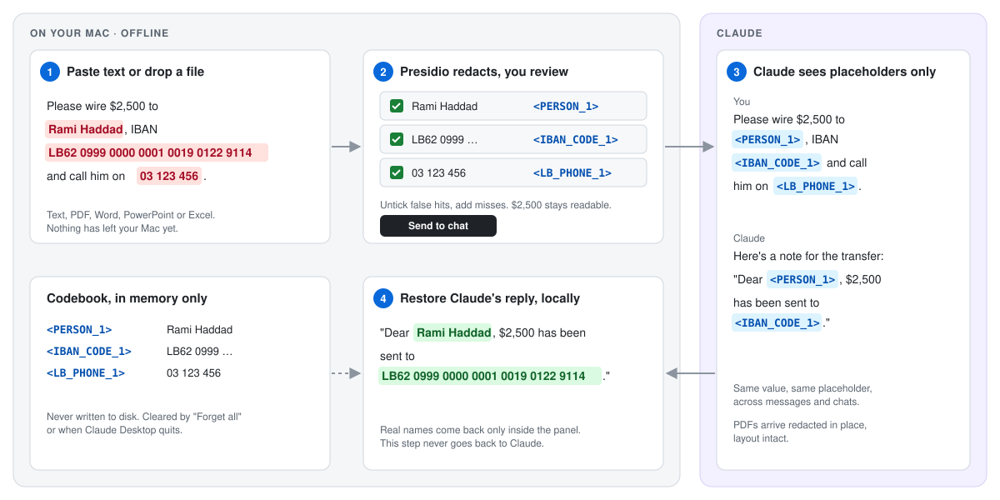

# LLM-Redact: private redaction for Claude Desktop

A redaction panel inside your Claude Desktop chat. Paste text or drop a file, and it's redacted on your Mac with [Microsoft Presidio](https://microsoft.github.io/presidio/) before anything reaches Claude. PDFs are redacted in place, keeping their layout. Claude's replies can be turned back into real names inside the panel, without that ever going back to Claude.

Tuned for Lebanese and Gulf work: Lebanese and Arab names, Lebanese and Gulf phone formats, IBANs in any spelling, and LBP/USD amounts left readable.

## How it works



- Claude sees only placeholders like `<PERSON_1>` and `<IBAN_CODE_1>`. The codebook stays in memory on your Mac.
- Claude can call only two tools: one opens the panel, one reads a PDF you already redacted. Redacting and restoring are panel-only.
- Everything runs locally as a child process of Claude Desktop. No network port is opened and no internet connection is made while redacting.

## Install

**Prerequisites:** Python 3.10 to 3.13 (not 3.14 yet) and Node.js 20+. With Homebrew: `brew install python@3.12 node`.

```
cd ~/Applications
git clone https://github.com/Loaded-16/LLM-Redact.git
cd LLM-Redact
bash setup.sh
```

Setup installs Presidio and the English model (about 600 MB), runs a self-check, and asks before adding the server to Claude Desktop's config (backed up first). Then quit Claude Desktop with **Cmd+Q** and reopen it.

Keep the folder somewhere permanent. If you move it, run `bash setup.sh` again.

### AI models and add-ons

Add flags to the setup command. They're remembered on later runs.

| Flag | What it adds | Download |
|---|---|---|
| `--gliner` | [GLiNER](https://github.com/urchade/GLiNER) PII model ([knowledgator/gliner-pii-base-v1.0](https://huggingface.co/knowledgator/gliner-pii-base-v1.0)) replaces spaCy for finding names. Better with unusual and non-English names, fewer false hits. | ~1.5 GB |
| `--arabic` | [OpenMed Arabic PII](https://huggingface.co/OpenMed/OpenMed-PII-Arabic-BigMed-Large-560M-v1) model for Arabic-script names, addresses and IDs | ~3 GB |
| `--ocr` | Redacts scanned PDFs with RapidOCR | ~80 MB |
| `--basic` | Switches all add-ons off | |

Example: `bash setup.sh --gliner --ocr`. Models download once during setup and then load offline only. The Lebanese name list, IBAN, account and amount rules stay active on top of either model. If a model fails to load, the redactor keeps working without it (GLiNER falls back to spaCy), and the panel's status pill shows which engines are active (for example "Presidio ready · local · GLiNER · OCR").

**Status:** GLiNER passes the self-check on macOS, and its accuracy against spaCy is still being compared. The Arabic model is only tested with a stand-in so far, so the self-check after `--arabic` confirms whether it loads.

## Use

1. In a new chat, ask Claude to **"open the redaction panel"**.
2. Paste text or drop a file (PDF, Word, PowerPoint, Excel or text, up to 10 MB). Never drag files into the chat box itself.
3. Optionally, under **What to hide**, add words to always hide, switch on places/dates/links, remove images from PDFs, or **flatten PDF pages** into pictures for the safest output.
4. Press **Redact**, then **Review what's hidden**: untick false hits, add misses, and press **Apply changes**.
5. Check the result and press **Send to chat** (or **Send redacted PDF to chat**).
6. Paste Claude's reply into **Restore Claude's reply** to see the real names.

The same value keeps the same placeholder until Claude Desktop quits. **Forget all** clears the codebook and cached PDFs.

## What it detects

Names (English model or GLiNER, plus ~450 Lebanese/Arab first names in Latin and 140 in Arabic script), Lebanese and Gulf phone numbers, IBANs (checksum-verified), labelled account numbers, long ID-like numbers, emails, card numbers, IP addresses, and your own words. Places, dates, nationalities and links are optional.

Left alone on purpose: currency amounts, short numbers in table cells, dates, years and short references.

## Limits

- Detection isn't perfect. Always check the preview before sending.
- Without `--arabic`, Arabic-script surnames aren't caught. Add them under "Always hide these words".
- Unlabelled account numbers of 10 digits or fewer in a table cell aren't hidden.
- Text inside images (logos, signatures, screenshots) isn't hidden. Use "Remove photos and images".
- Every redacted PDF is re-read before sending. If a detected value is still readable, only the text version is offered.
- Redacted PDFs (never originals) are cached in `~/Library/Caches/presidio-redactor` for up to 24 hours.
- About 100 pages per redaction.

## Update and remove

```
git pull && bash setup.sh     # update, then restart Claude Desktop
bash uninstall.sh             # remove, then restart Claude Desktop and delete the folder
```

## Troubleshooting

- **No panel:** quit Claude Desktop with Cmd+Q and reopen. Check **Settings ▸ Developer** shows `presidio-redactor` running.
- **"Presidio not running" or an add-on missing from the status pill:** run `bash setup.sh` again (with the add-on's flag). The self-check says what failed.
- **"This PDF is scanned":** run `bash setup.sh --ocr`.
- **Logs:** `~/Library/Logs/Claude/mcp-server-presidio-redactor.log`

## Development

```
python3 -m venv .venv && .venv/bin/pip install -r requirements.txt reportlab
.venv/bin/python -m spacy download en_core_web_lg
npm install
npm run build          # rebuilds dist/ from src/ (commit dist/ too)
npm run test:worker
npm run test:server
npm run test:ui        # needs Chromium; set CHROME_PATH
```

The GLiNER and Arabic tests use stand-in models, so no download is needed. Model code lives in `worker/models.py`.

## Credits and licence

Built on [Presidio](https://github.com/microsoft/presidio), [spaCy](https://spacy.io), the [MCP Apps SDK](https://github.com/modelcontextprotocol/ext-apps) (all MIT) and [PyMuPDF](https://pymupdf.readthedocs.io) (AGPL-3.0). Add-ons: RapidOCR, GLiNER and OpenMed Arabic PII (Apache-2.0). Check each model's licence before using it at work.

Because of PyMuPDF's AGPL licence, keep this repository private or release it under the AGPL if you share it.

Author: Jad Chidiac. Personal project, not affiliated with Microsoft or Anthropic.
